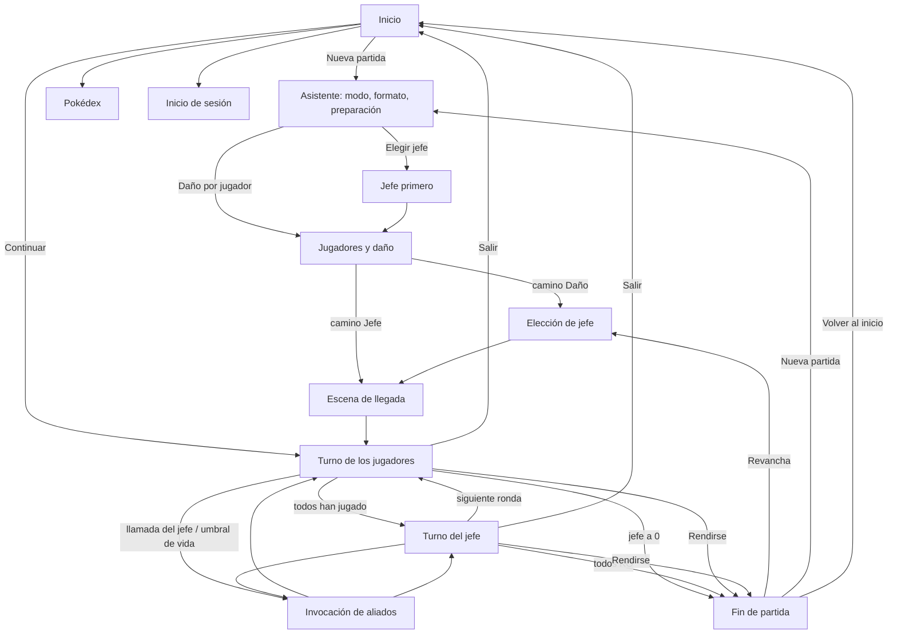
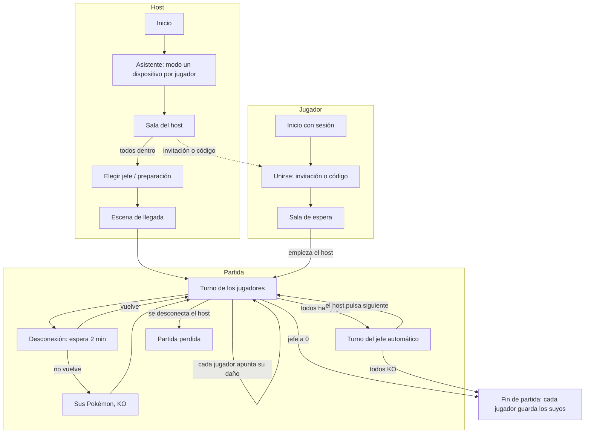

# Mapa de pantallas y flujos (T-54, #155)

Inventario de las pantallas que existen hoy en la app y diagrama de flujo de los dos modos de juego decididos en T-53 (#154):

1. **Host único:** la tablet la lleva el host y todos juegan en ese dispositivo. Es lo que hace la app hoy.
2. **Un dispositivo por jugador:** cada jugador usa su pantalla (móvil, tablet o PC). **No existe todavía** (arquitectura en #158). Las reglas están cerradas (T-53 y las decisiones del 2026-11-18, §4); las pantallas concretas son una **PROPUESTA** sin aprobar.

**Los modos y los formatos van de la mano** (decidido el 2026-11-18, no se admite partida mixta): el *host único* es el **formato físico** (todos en la mesa) y *un dispositivo por jugador* es el **formato digital** (cada uno en su dispositivo, online). Ver `flujo-app.md` §1 bis.

Sustituye a la tarjeta suelta T-18 (bocetos). El flujo de producto (inicio, formatos, Pokédex, cuenta) ya está aprobado en `flujo-app.md` (T-58); aquí se baja a pantallas concretas.

## 1. Inventario de pantallas actuales

La app tiene pocas «rutas». Casi todo ocurre en una sola pantalla de partida que cambia de contenido según la fase del motor.

| # | Pantalla | Archivo | Cuándo aparece | Qué hace |
|---|---|---|---|---|
| 1 | Inicio | `inicio.dart` | Al abrir la app | Nueva partida (o Continuar si hay una guardada), Pokédex y cuenta. En móvil, menú propio. |
| 2 | Nueva partida (asistente) | `nueva_partida.dart` | Desde Inicio | Tres pasos con carril: Modo de juego → Formato → Preparación. Hoy solo hay una opción útil en cada uno (partida libre, físico) y se elige entre «Daño por jugador» y «Elegir jefe». |
| 3a | Jugadores | `setup.dart` (`PantallaJugadores`) | Fase *preparación*, camino «Daño por jugador» | Nombres y daño de cada jugador. Aviso si el equipo no encaja con el jefe (no bloquea). |
| 3b | Jefe primero | `setup.dart` (`PantallaJefePrimero`) | Fase *preparación*, camino «Elegir jefe» | Elegir el jefe; la tarjeta muestra el daño recomendado. Después se piden los jugadores. |
| 4 | Elección de jefe | `setup.dart` (`PantallaEleccionJefe`) | Fase *elección de jefe* | Lista de jefes del nivel que salió del daño del equipo. |
| 5 | Escena de llegada | `escena_entrada.dart` | Al empezar la partida | Animación de entrada del jefe sobre la mesa. |
| 6 | Turno de los jugadores | `turno_jugadores.dart` + `mesa.dart` | Fase *turno de jugadores* | Mesa a pantalla completa con cámara; panel con el turno actual (daño al jefe, ataque a un aliado, cartas de ánimo, estados, KO). Orden de la ronda en «Más acciones». |
| 7 | Turno del jefe | `turno_jefe.dart` + `mesa.dart` | Fase *turno del jefe* | Robar carta del jefe, registrar su ataque (objetivo, daño, potenciadores, monedas), chequeo Pokémon, quemaduras, terminar turno. |
| 8 | Invocación de aliados | `pendientes.dart` | Durante cualquiera de los dos turnos | Diálogo de tirada de dado y aparición de un aliado; también el ataque de los aliados. Salta por eventos del motor (llamada del jefe, umbrales de vida). |
| 9 | Fin de partida | `fin_partida.dart` | Fase *terminada* | Resultado, resumen por jugador, guardado de resultados (pide iniciar sesión si no hay) y tres salidas: Revancha, Nueva partida y Volver al inicio. |
| 10 | Pokédex | `pantalla_pokedex.dart` | Desde Inicio | Enemigos por expansión (jefes y aliados enfrentados). «Mis cartas» no existe todavía. |
| 11 | Inicio de sesión | `cuenta/pantalla_login.dart` | Desde Inicio, la barra de la partida o Fin de partida | Entrar o registrarse. Perfil, historial y amigos **no existen** como pantallas. |

### Elementos transversales

| Elemento | Dónde | Qué hace |
|---|---|---|
| Barra flotante de la partida | Sobre la mesa en las fases de turno | Ronda y turno, deshacer, rehacer, envíos, cuenta y abandonar. |
| Abandonar | Diálogo desde la barra | **Salir** (guarda y vuelve a Inicio) o **Rendirse** (pasa a Fin de partida). |
| Menús de objetivo | `acciones_objetivo.dart` | Estados y acciones sobre jefe, aliado o jugador. |
| Avisos centrales | `aviso_central.dart` | Carteles animados de eventos, de uno en uno. |
| Moneda y dados en la mesa | `moneda.dart`, `dados_en_mesa.dart`, `monedas_en_mesa.dart` | Tiradas animadas sobre la mesa. |
| Envíos | `envios/` | Cola de resultados pendientes de subir al servidor. |

## 2. Modo host único (el actual)

Un solo dispositivo. El host introduce todo: los datos de todos los jugadores, el daño de cada turno y el turno del jefe.

Notas:
- Las tres salidas de Fin de partida ya existen. «Volver al inicio» no descarta nada: la partida queda como Continuar.
- Deshacer y rehacer valen en todas las fases de turno.
- Con una partida a medias, la app hoy la retoma sola al abrirse; el flujo aprobado la convierte en el botón **Continuar**.

## 3. Modo un dispositivo por jugador (PROPUESTA)

Reglas cerradas (T-53 y decisiones del 2026-11-18):

- Es el **formato digital**: solo online, con sesión **obligatoria** para todos los jugadores, y da puntos.
- Cada jugador apunta **su propio daño** cuando es su turno.
- La **baraja de ataques del jefe está en la app**, así que el turno del jefe es automático: la app roba la carta y resuelve el ataque. La acción de «siguiente» la hace el **host**.
- Todos ven lo mismo: la mesa con la cámara en el momento de la partida (la cámara sigue al estado, no a cada jugador).
- **No hay deshacer ni rehacer**: no existen en el formato digital.
- **No hay partida mixta:** o todos en su dispositivo, o todos en físico.
- Desconexión de un jugador: se espera 2 minutos con un mensaje para todos; si no vuelve, sus dos Pokémon se dan por muertos. **Si se desconecta el host, se pierde la partida.**
- Las monedas y dados del turno del jefe los tira el jefe (la app); los jugadores no intervienen.
- Se entra por **invitación dentro de la app** o con un **código**.
- Al terminar, **cada jugador guarda sus propios resultados**.

Roles y qué ve cada uno:

| | Host | Jugador |
|---|---|---|
| Crear la partida y elegir jefe/preparación | Sí | No |
| Invitar o dar el código | Sí | No |
| Ver la mesa | Sí | Sí, la misma |
| Apuntar daño en su turno | Solo el suyo | Solo el suyo |
| Pasar del turno del jefe a la ronda siguiente | Sí | No |
| Deshacer/rehacer | No existe | No existe |
| Abandonar o desconectarse | Se pierde la partida para todos | Se desconecta (ver desconexión) |
| Guardar sus resultados al final | Los suyos | Los suyos |

Pantallas nuevas o distintas respecto al host único:

| Pantalla | Quién | Qué es |
|---|---|---|
| Elegir formato | Host | El paso «Formato» del asistente ya existe: «Digital» lleva a este modo (hoy no disponible). |
| Sala del host | Host | Muestra el código, deja invitar desde la app y enseña quién ha entrado. Empieza cuando están todos. |
| Unirse | Jugador | Aceptar una invitación o introducir un código. Usa su sesión, que es obligatoria. |
| Sala de espera | Jugador | «Esperando a que el host empiece». |
| Mesa de jugador | Jugador | La misma mesa; los controles solo se activan en su turno. Fuera de su turno ve de quién es. Sin deshacer ni rehacer. |
| Aviso de desconexión | Todos | Cuenta atrás de 2 minutos con el nombre del jugador que falta. |
| Fin de partida | Todos | Resultado y resumen; cada jugador guarda los suyos. |

## 4. Decisiones (2026-11-18) y lo que queda abierto

Decidido:

| Pregunta | Decisión |
|---|---|
| Turno del jefe «automático» | La baraja de ataques del jefe está en la app. La app roba la carta y resuelve el ataque; el host solo pasa al siguiente turno. |
| Cómo se entra | Invitación dentro de la app o código. |
| Deshacer y rehacer | No existen en el formato digital. |
| Partida mixta | No se admite: o cada uno en su dispositivo, o todos en físico. |
| Sesión | Obligatoria en el modo un dispositivo por jugador. |
| Fin de partida | Cada jugador guarda sus propios resultados. |
| Monedas y dados del turno del jefe | Los tira el jefe, es decir, la app, sin intervención de los jugadores. |
| Desconexión del host | Se pierde la partida. |

Efectos a vigilar en otras tarjetas:

- **T-57 (#158):** sin deshacer, el servidor no necesita historial reversible; basta un registro de eventos en un solo sentido. La sesión obligatoria simplifica la identidad de los jugadores (D-11).
- **Turno del jefe en digital:** hoy el host único ya roba la carta del jefe en la app, pero registra el ataque a mano (objetivo, daño, monedas). En digital esa entrada manual desaparece y la app tira las monedas y dados del jefe y resuelve el ataque; queda para T-57 cómo se elige el objetivo cuando depende de una tirada.
- **Invitaciones dentro de la app** necesitan amigos (T-64, #237).

Abierto: nada por ahora en esta tarjeta.

## 5. Qué no cubre este documento

- Formato digital, campaña, tienda y «Mis cartas»: siguen como **TODO** en `flujo-app.md`.
- Aspecto visual: es de T-55 (sistema de diseño) y T-56 (maquetas).
- Protocolo de sincronización y host autoritativo: es de T-57 (#158).
